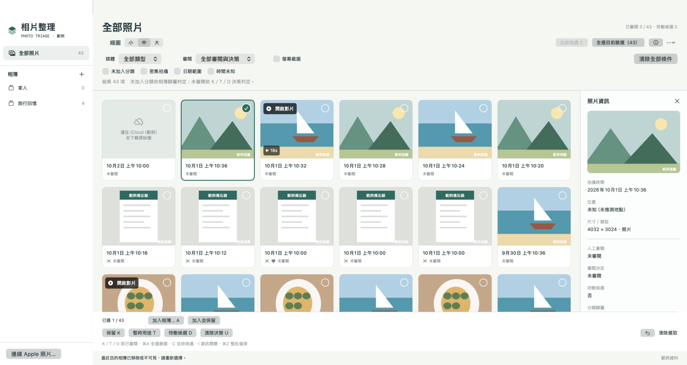
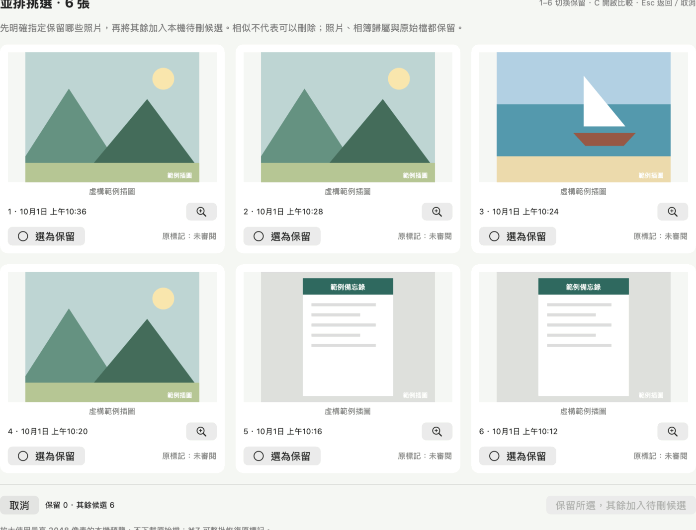
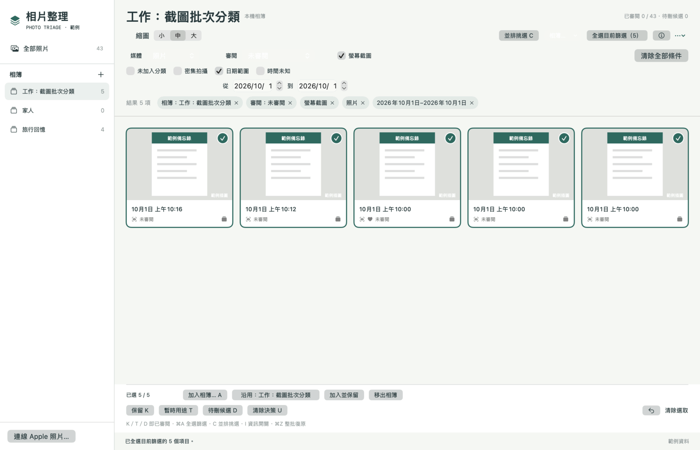
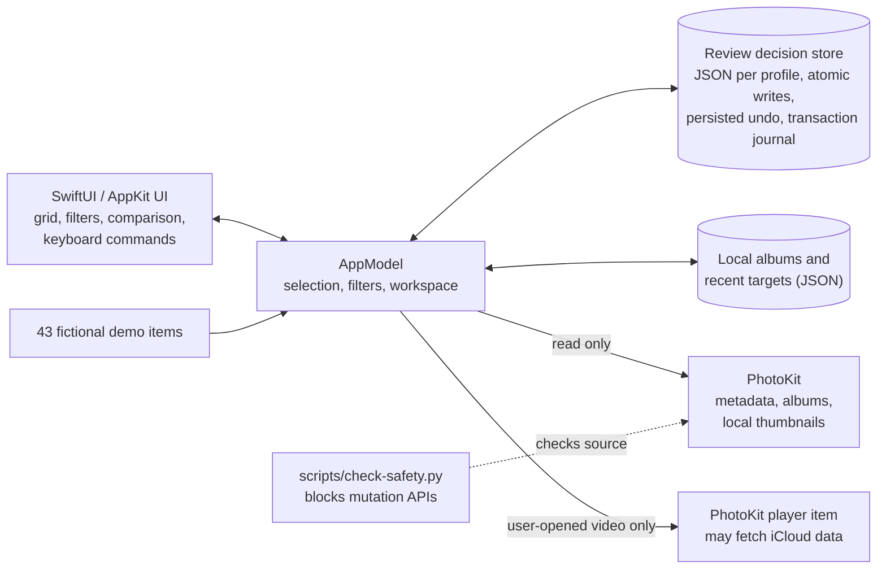

# PhotoTriageMac



**A native macOS app for reviewing a large Apple Photos library quickly, where every decision is a reversible local record and the app never changes the library itself.** Built with SwiftUI, AppKit and public PhotoKit APIs. The interface is in Traditional Chinese; it starts with 43 fictional illustrated items, so the workflow can be tried without granting Photos access.

Current version: **0.5.5, build 15**. The app bundle is `Photo Triage Organizer.app`; the version is recorded inside the bundle.

## What it does

- **Fast keyboard review.** Mark items keep (K), temporary-purpose (T) or deletion candidate (D); any of these counts as reviewed. U clears the decision, and ⌘Z undoes whole batches, even after a restart.
- **Side-by-side comparison.** Select 2–6 similar photos, zoom, pick the keepers with 1–6, and stage the rest as deletion candidates in one undoable action. Nothing is deleted.
- **Combined filters.** Album, media type, screenshots, review decision, unclassified, dense capture and date range combine, each shown as a removable chip.
- **Local albums.** Create, rename and fill local albums, reuse the most recent target album, and add-and-keep a batch in one step. Album membership is kept separate from review status.
- **Resume where you left off.** Album, filters, selection, thumbnail size (small, medium, large), details panel and scroll position are restored on relaunch. Videos play in place when you open them.

| Compare 2–6 photos | Combined filters |
| --- | --- |
|  |  |


## Architecture



PhotoKit's read/write authorization is required even to read metadata, but the source contains no Photos mutation call: a static check in `scripts/check-safety.py` fails the build verification if one appears.

## Quick start

Requirements: macOS 14 or later, a Swift 6 toolchain (Xcode or Command Line Tools), Python 3 for the source checks. No third-party Swift packages or paid services.

```sh
git clone https://github.com/DancinAndrew/PhotoTriageMac.git
cd PhotoTriageMac
bash scripts/verify.sh                       # safety and publication checks, then the Swift tests
bash scripts/build-organizer-app.sh release  # creates dist/Photo Triage Organizer.app
bash scripts/run-organizer.sh
```

For an isolated demo profile: `bash scripts/run-organizer.sh --review-root "$PWD/.qa-data/demo"`.

The build has a local ad-hoc signature; it is not notarized or distributed through the App Store. The build archives a previous local bundle before replacing it. A new ad-hoc signature may reset Photos authorization; approve any new native Photos prompt yourself. The run script prevents a second organizer process from sharing the review files. Use the complete `.app` for real-library access and offline travel resources; `swift run` lacks the bundle's Photos usage description. Building and testing do not request Photos permission or enumerate your library.

## Results

- `bash scripts/verify.sh` on an Apple Silicon Mac (2026-11-23): source safety check passed, publication check passed, **135 XCTest tests passed, 0 failed, 0 skipped**. The release build and code-signature check also passed.
- Tests use fictional data and temporary profiles. Coverage includes thumbnail sizes and restart, inspector and selection, K/T/D review states with older records, clear-and-undo, combined filters, recent targets, repeated actions, paired undo after restart, interrupted saves, stale writes, empty data, denied access, missing metadata, video preview loading and cancellation on a synthetic clip, and native view rendering offscreen.
- Version 0.5.1 additionally passed 27 native foreground checks using macOS CGEvent input and accessibility observations (copy/cut/paste, text undo/redo, comparison keepers, zoom, cancellation, atomic photo undo, repeated operations) on fictional isolated profiles.
- CI on GitHub's hosted Intel macOS runner runs the same checks and builds the app; it skips one GPU-dependent grid geometry test because that VM has no usable Metal target.

## Photos permission and local data

Choose the connect-to-Photos action to request Apple's native permission prompt. On later launches, the last Photos profile resumes only if permission is already available; automatic resume never requests permission. Denied or restricted access shows a clear state and the fictional demo remains available. Limited access displays only the assets PhotoKit exposes; counts do not represent inaccessible items.

Metadata, existing album references and small locally available thumbnails are read through public APIs. Network access for thumbnail and comparison requests is disabled. Comparison previews request at most 2048 × 2048 pixels; they are not original-resource requests. Low-resolution, iCloud-only, unavailable and failed previews are labeled explicitly. The one exception is a video you explicitly open (button, double-click or Space): that single request may let PhotoKit fetch the iCloud data needed to play it, with visible progress and a cancel option.

Review decisions, local albums, recent destinations, display preferences and workspace positions are saved separately in `~/Library/Application Support/PhotoTriageMac/`. Demo and real-library profiles use separate JSON files. Saves use private file permissions and atomic replacement. Unreadable, incompatible or externally changed data blocks writes instead of being overwritten. Missing asset references remain available for reconciliation. Use one running instance per profile.

These local files and optional analysis/export reports can contain Photos identifiers and personal metadata. Keep them private. The repository contains code, fictional fixtures, a synthetic test video, an original icon and public offline geography only. It contains no personal photos, Photos identifiers, song inventories, travel receipts or review databases. No photo or metadata is uploaded by the app.

## Keyboard workflow

| Key | Action |
| --- | --- |
| ⌘A | Select the currently filtered items |
| C | Compare 2–6 selected images |
| 1–6 / Esc | Toggle explicit keepers in comparison / return or cancel |
| Space | Open the selected video |
| ⌘N | Create a local album |
| K / T / D | Keep / toggle temporary purpose / stage deletion candidate |
| U | Clear the review decision (album membership is kept) |
| A | Choose a target local album |
| ⇧A | Reuse the most recent valid target album |
| ⌘⇧A | Add to the recent target and keep the undecided items |
| ⌘Z | Undo text when editing; otherwise undo the last organizer action |
| ⌘⇧Z | Redo text while editing |
| ← / → / I | Previous / next / toggle the details panel |

Editing text or using a modal prevents photo-review shortcuts from acting on the grid.

## Limitations

- “Temporary”, “useless” and deletion candidates are human judgments. Dense capture is a review hint, not duplicate detection; comparing and zooming do not assess quality automatically.
- The app does not delete photos or write Apple Photos albums. Local albums are local overlays; adding to one does not remove an item from All Photos or any Photos album. Any future Photos write would need a separately reviewed implementation and explicit user confirmation. Task-specific mutation jobs from private builds are intentionally absent from this public source.
- Event and travel suggestions (from dates, time gaps and nearby coordinates) are approximate and should be reviewed. Optional travel analysis and on-device music screenshot OCR only produce suggestions and local reports.
- Automated checks use fictional profiles and a synthetic video. They do not establish real-library authorization, iCloud playback or preview availability on another Mac.
- Ad-hoc signed only; macOS may ask for Photos permission again after each rebuild.

Optional actual-app UI verification (after building; use a fresh fictional profile):

```sh
mkdir -p "$PWD/.qa-data/ui-evidence"
bundle="$PWD/dist/Photo Triage Organizer.app/Contents/MacOS/PhotoTriageMac"
"$bundle" --review-root "$PWD/.qa-data/ui-profile" --ui-qa "$PWD/.qa-data/ui-evidence/first.json"
"$bundle" --review-root "$PWD/.qa-data/ui-profile" --ui-qa "$PWD/.qa-data/ui-evidence/resume.json" --ui-qa-resume
```

This mode rejects a Photos profile, never connects Photos, stays offscreen, and exits nonzero for a failed check. It does not replace a foreground keyboard or real-library permission check.

Design notes: [ADR 0001](docs/adr/0001-native-read-only-organizer.md) and the [review requirements](openspec/specs/photo-review/spec.md).

## Attribution and licensing

Offline geography is adapted from the public-domain Natural Earth dataset; see [its attribution](Resources/Travel/ATTRIBUTION.txt). All other source is provided without an open-source license grant. Public visibility does not grant reuse rights beyond GitHub's applicable terms.
